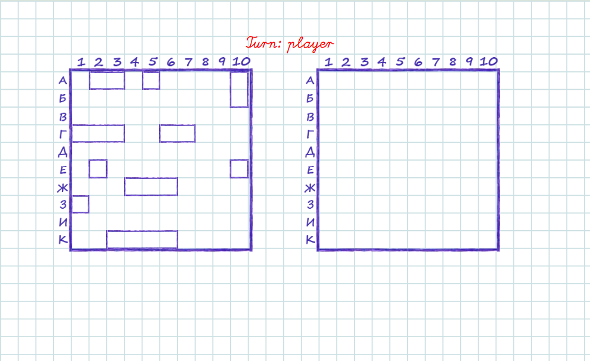

# Battleship

A browser-based Battleship game built with React and Redux. Place your ten ships on the grid, either randomly or by dragging them yourself, and then take turns firing at the computer's hidden fleet. The first side to sink all enemy ships wins.



## How to play

1. Choose how to place your ships: **Random** or **Manually**.
2. If placing manually:
   - drag a ship with the left mouse button;
   - double-click a ship to rotate it.
3. When all ten ships are placed, press the start button.
4. Click cells on the enemy field to fire. Right-click a cell to mark where an enemy ship cannot be located.

## Getting started

The app lives in the `my-app` folder.

```
cd my-app
npm install
npm start
```

Then open http://localhost:3000 (the port may differ if 3000 is busy; the terminal will tell you).

Other commands:

- `npm run build` - production build into `my-app/build`
- `npm test` - run tests

### Requirements

Node.js 16 or newer (tested with Node 24) and npm.

## Tech stack

React 16, Redux / React Redux, React Router 5, Create React App (react-scripts 5).
